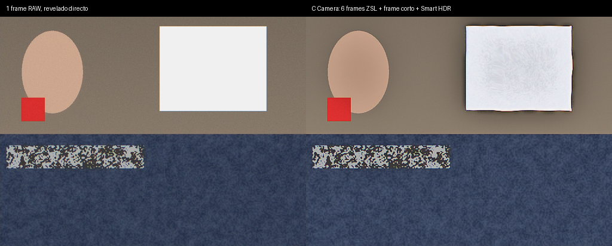
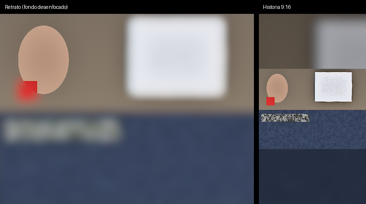

# C Camera

Cámara para Android de **Carmelita Softworks** que procesa las fotos como un iPhone: guarda los
fotogramas de **antes** de pulsar (zero shutter lag), los **alinea y fusiona en RAW**, recupera las
luces con un fotograma corto (**Smart HDR**) y guarda en **Ultra HDR**. Tiene **Fotos en vivo**,
**Retrato**, **Noche**, **Vídeo 4K**, **lector de QR** y una exportación pensada para que
**Instagram** muestre las fotos lo mejor posible.

Kotlin · Camera2 · Jetpack Compose · motor de imagen en C++ (NDK) · ML Kit · minSdk 26



*Ráfaga RAW sintética de prueba: a la izquierda, un frame revelado directamente; a la derecha, el
pipeline completo. Las sombras ganan +7 dB de señal/ruido, la ventana quemada recupera su textura y
el objeto en movimiento no deja fantasmas.*

## Qué hace

| Función | Cómo |
|---|---|
| **Fusión multi-frame** (Deep Fusion / HDR+) | 6 frames RAW (o YUV) del búfer ZSL; alineación jerárquica con precisión subpíxel; fusión robusta según el perfil de ruido del sensor |
| **Zero shutter lag** | Un búfer circular guarda los últimos frames: la foto es el instante en que pulsas, no un poco después |
| **Smart HDR** | Un frame subexpuesto (−2,6 EV) recupera las luces; tone mapping local (Mertens) con filtro guiado y reescalado bilateral para evitar halos |
| **Ultra HDR** (Android 14+) | Mapa de ganancia: en pantallas HDR las luces brillan; en las demás se ve la versión SDR |
| **Fotos en vivo** | Codificador H.264 continuo; ~1,5 s antes y después del disparo, guardado como *Motion Photo* (Google Fotos y la galería lo reproducen) |
| **Noche** | 8 exposiciones largas (hasta 1/6 s con OIS) a ISO bajo |
| **Retrato** | Segmentación de personas (ML Kit, en el dispositivo) + desenfoque con bokeh en las luces |
| **Flash** | Apagado / automático / encendido con precaptura; linterna en vídeo |
| **Vídeo** | 4K o 1080p, 30/60 fps, HEVC si está disponible, estabilización y audio estéreo |
| **Estilos fotográficos** | Estándar, Contraste intenso, Vibrante, Cálido y Frío |
| **Lector de QR** | Automático en el visor: enlaces, Wi‑Fi (diálogo del sistema para conectarse), contactos, eventos, teléfono, correo, SMS y ubicaciones |
| **Detección de la cámara** | Al abrirse comprueba qué soporta el teléfono y prueba sesiones de la mejor a la más básica (RAW+ZSL+en vivo → … → YUV). La pantalla *Info de cámara* lo muestra todo |

### Instagram

Desde el visor de la última foto, **Instagram** prepara una copia y abre la app:

- **Tamaño exacto** con 1080 px de ancho, así Instagram no la vuelve a escalar: **3:4 (1080×1440)**,
  que es el formato más alto del feed y el único que la cuadrícula del perfil no recorta (y
  coincide con el 4:3 del sensor), además de 4:5, 1:1 e Historia 9:16 (sobre fondo desenfocado).
- **Reducción Lanczos en luz lineal** + un enfoque de salida suave que compensa la recompresión.
- **JPEG de calidad 95** y **Ultra HDR conservado**: Instagram en Android muestra las fotos HDR.



## Arquitectura

```
app/src/main/
├── cpp/                      motor nativo (C++17, multihilo)
│   ├── core/image.*          planos, filtros, Lanczos, filtro guiado, sRGB
│   ├── core/burst.*          alineación subpíxel + fusión robusta (Bayer o YUV)
│   ├── core/finish.*         revelado RAW (sombreado de lente, balance, demosaico MHC, matriz de color),
│   │                         Smart HDR, estilos, mapa de ganancia Ultra HDR
│   ├── core/outputs.cpp      retrato, exportación para Instagram, historia
│   ├── jni_bridge.cpp
│   └── tests/                pruebas en el host (sin Android)
└── java/com/carmelita/ccamera/
    ├── camera/               Camera2, detección de capacidades, ZSL, Fotos en vivo, vídeo
    ├── processing/           NativeEngine (JNI), PhotoJob, Retrato
    ├── storage/              guardado, EXIF y Motion Photo (Kotlin puro, con pruebas)
    ├── share/                exportación e intent de Instagram
    ├── qr/                   lector e intérprete de QR
    └── ui/                   Compose
```

## Compilar

El workflow de GitHub Actions **no se ejecuta solo**: lánzalo desde *Actions → Build → Run workflow*
(o subiendo un tag `v*`, que además publica el APK en una Release).

En local:

```bash
# Pruebas del motor nativo (sólo necesita cmake y un compilador de C++)
cmake -S app/src/main/cpp/tests -B build-tests && cmake --build build-tests && ./build-tests/foton_tests

./gradlew testDebugUnitTest   # pruebas Kotlin (EXIF, Motion Photo, QR)
./gradlew assembleRelease     # APK en app/build/outputs/apk/release/
```

Hace falta JDK 17 y el Android SDK con NDK (Android Studio los instala).

> El APK de release se firma con la clave de debug para poder instalarlo directamente. Antes de
> publicarlo en una tienda, configura tu propia `signingConfig`.

## Estado y límites

- El motor nativo y los formatos de archivo están probados (pruebas en el host). **La app aún no se
  ha compilado ni probado en un teléfono**: es el siguiente paso.
- Cada fabricante expone cosas distintas en Camera2. Si un teléfono no da RAW, ZSL o el codificador
  de Fotos en vivo, la app baja automáticamente a lo que sí funciona (lo verás en *Info de cámara*).
- Los teléfonos con sensor de 50 MP suelen dar RAW binned de 12,5 MP; la app limita la resolución de
  la fusión según la memoria del teléfono.
- Las Fotos en vivo no llevan audio.
- El modo Retrato separa personas; no mascotas ni objetos.

## Licencia

GPL-3.0 (ver `LICENSE`). Usa ML Kit de Google (gratuito pero no libre) para el QR y el retrato.
